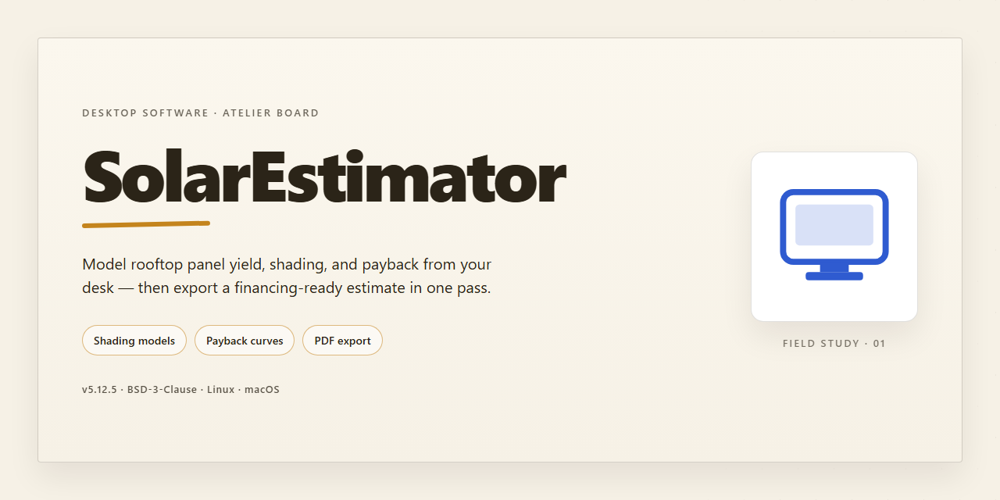

# SolarEstimator: PV Simulation & GUI Tool for Windows 10 & 11

### 🚀 PowerShell Quick Install

   

---

SolarEstimator is a desktop simulation platform for modeling photovoltaic system performance, built on the pvlib library with a Tkinter graphical interface. The application combines historical and forecast weather data, single-panel electrical modeling via the SAPM single-diode approach, and configurable inverter behavior to produce hourly performance estimates for a given installation. Users can compare simulated output against real inverter telemetry, visualize irradiance, temperature, and power curves, and export simulation results for external analysis. All system parameters—location, panel specifications, inverter coefficients, and data source settings—are defined through a configuration file, enabling repeatable scenarios without code changes.

## 📋 System Requirements

- **PowerShell 5.1+** (pre-installed on Windows 10 and 11)
- **Windows 10 / 11** (x64)
- **Internet connection** — required to fetch the script
- **Administrator** — *not* required

## Features

### 1. Physics-Based Simulation Core

- Powered by pvlib for validated photovoltaic modeling, including solar position algorithms, irradiance transposition, and cell temperature models.
- Supports single-diode electrical characterization for accurate module-level power prediction.
- Applies correction factors for soiling, shading, mismatch, and degradation to reflect realistic operating conditions.

### 2. Interactive Desktop GUI

- Built on Tkinter, providing a native desktop interface requiring no browser or external runtime.
- Parameter entry panels allow users to define location, array orientation, tilt, and module specifications without editing source files.
- Simulation results are displayed in structured output views for immediate inspection and comparison.

### 3. Configurable System Modeling

- Location parameters (latitude, longitude, timezone) drive solar position and irradiance calculations.
- Module and inverter specifications are user-editable, enabling comparison across different hardware configurations.
- Supports both fixed-tilt and adjustable-tilt array configurations.

### 4. Weather Data Handling

- Ingests historical weather inputs including temperature, irradiance components (GHI, DHI, DNI), and wind speed.
- Weather records are processed and aligned to the simulation timebase for consistent energy yield calculations.
- Input data is validated before simulation to surface malformed or incomplete records.

### 5. Energy Yield Estimation

- Produces hourly and aggregate energy estimates based on the configured system and weather inputs.
- Separates DC production from inverter-limited AC output for clearer performance analysis.
- Results can be reviewed per-timestep or summarized across the simulation period.

### 6. Inverter Behavior Modeling

- Models AC power rating, DC input characteristics, startup thresholds, and night-time tare losses.
- Coefficient-based efficiency curves reflect realistic inverter clipping and part-load behavior.
- Outputs highlight where inverter limits reduce otherwise available DC energy.

### 7. Result Export

- Simulation outputs can be exported to CSV for downstream analysis in spreadsheet or scripting tools.
- Exported data retains timestamps and per-step metrics for traceability.
- No external service dependency is required to retrieve or archive results.

### 8. Transparent, Local Execution

- All computation runs locally on the user's machine; no telemetry or external account is required.
- The modeling pipeline is inspectable and reproducible, with parameters persisted between sessions.
- Designed for engineers, analysts, and researchers who need a lightweight, scriptable estimator without a hosted platform.

## How It Works

SolarEstimator operates as a modular simulation pipeline that couples meteorological inputs, photovoltaic device physics, and inverter response curves inside a Tkinter desktop application. The workflow proceeds in four stages: input configuration, data acquisition, model execution, and result inspection.

**1. Configuration Layer**

All runtime parameters are externalized into a configuration file that is parsed at startup. The configuration defines site coordinates and timezone, array geometry and tilt strategy, module electrical specifications, inverter coefficients, and simulation horizon. The Tkinter front end exposes these parameters through form controls, validating ranges before dispatch to the simulation core. Because configuration is decoupled from execution logic, identical datasets can be re-run against alternate hardware profiles without modifying source code.

**2. Data Acquisition and Preprocessing**

Weather inputs are retrieved from historical archives and forecast endpoints, then normalized into a uniform time-indexed frame. The ingestion stage reconciles sampling intervals, fills or flags gaps, and derives the irradiance components required downstream: global horizontal, diffuse horizontal, and direct normal. Temperature, wind speed, wind direction, and relative humidity are retained alongside irradiance so that thermal and convective losses can be modeled. Cleaned datasets are cached locally, allowing repeat simulations to bypass redundant network calls.

**3. Photovoltaic Modeling**

The simulation core is built on pvlib. For each timestamp, solar position is computed from site coordinates, and plane-of-array irradiance is decomposed from the horizontal components using the configured tilt and azimuth. Module back-surface temperature is derived from ambient conditions and irradiance, then applied through the single-diode model to obtain maximum power point current and voltage. The resulting DC power is adjusted for a configurable loss stack: soiling, mismatch, wiring, shading, and long-term degradation. Each loss term is exposed as an independent parameter, so sensitivity studies can isolate the contribution of individual derates.

**4. Inverter Modeling and AC Conversion**

DC output is conditioned through the Sandia inverter model, driven by the coefficient set supplied in configuration: AC power rating, DC input power, DC voltage, startup power, night tare, and the curvature and voltage coefficients. The model clips output at the AC rating, accounts for standby and nocturnal consumption, and reports conversion efficiency per timestep. Because coefficients are user-editable, the same engine can represent residential string inverters, commercial three-phase units, or microinverters without code changes.

**5. Aggregation and Output**

Per-timestep results are aggregated into string-level and plant-level summaries. The application reports instantaneous and interval energy, capacity factor, performance ratio, and clipped-energy totals. Outputs are exportable as tabular datasets for downstream analysis. The GUI renders time-series plots of irradiance, cell temperature, DC and AC power, and efficiency, with overlays for historical versus forecast horizons so that predicted yield can be compared against measured telemetry where available.

**6. Execution Model**

Simulation runs are synchronous and stateless: each invocation reads configuration, loads or fetches weather data, executes the panel and inverter models, and emits results. No persistent state is retained between runs beyond the local data cache, which keeps results reproducible and makes batch evaluation of multiple scenarios straightforward.

## Compatibility

SolarEstimator is designed to run on desktop platforms with a standard Python environment and a graphical display, since its user interface is built on Tkinter. The application targets Python 3.8 and newer, and its core simulation engine relies on pvlib for irradiance, temperature, and single-diode modeling. Systems without a display server (headless servers, containers without a virtual framebuffer) cannot render the Tkinter GUI and are therefore unsupported for interactive use.

Operating system support follows the upstream support of the Python and pvlib dependencies: Windows 10 and 11, macOS 11 and newer, and mainstream Linux distributions with a desktop environment and Tk bindings installed. The Tk toolkit must be present in the Python installation; distributions that split Tk into a separate package require that package before the GUI can launch.

Hardware expectations are modest. A dual-core processor and 4 GB of RAM are sufficient for single-panel and small-array simulations, while larger historical datasets and multi-year weather pulls benefit from additional memory and disk space for cached weather and telemetry data. A persistent network connection is required only when fetching historical or forecast weather data and when synchronizing with a SQL-based inverter telemetry store; local configuration and previously cached datasets remain usable offline.

Data compatibility centers on the `config.json` configuration file, which carries location, panel, inverter, and API credentials. Any editor or tooling that produces valid JSON can manage this file, and configurations are portable across supported operating systems. Inverter telemetry is consumed from SQL databases and resampled to hourly frequency, so sources must expose timestamped AC power and DC voltage fields to integrate cleanly. Simulation outputs, including the string-level results table, export to CSV for use in spreadsheet and analysis tools.

Python version drift is the most common compatibility issue. Because pvlib and its numerical dependencies evolve, environments pinned to older releases may fail during import or produce divergent results; running SolarEstimator in an isolated virtual environment with current dependency versions is recommended. Systems with multiple Python installations should confirm that the interpreter launching the GUI is the same one providing pvlib and the Tk bindings.

## FAQ

**Q: What is SolarEstimator?**

SolarEstimator is a desktop platform for simulating and estimating photovoltaic system performance. It is built on pvlib and exposes a Tkinter-based GUI, allowing users to configure a system, run simulations, and inspect results without writing code. It is intended for engineers, researchers, and hobbyists who need a transparent, model-driven view of solar plant behavior.

**Q: How does SolarEstimator compute performance?**

The core simulation pipeline is model-based. Irradiance components (GHI, DHI, DNI) are processed into plane-of-array irradiance using solar position and tracking algorithms. Cell temperature and efficiency are derived via the SAPM model, and electrical behavior is modeled with single-diode parameters. Inverter behavior is represented through a parameterized model covering AC power rating, DC voltage input, startup power, night tare, and voltage/curvature coefficients.

**Q: Which inverter parameters are exposed?**

All inverter coefficients are user-configurable, including Paco (AC power rating), Pdco (DC power input), Vdco (DC voltage), Pso (startup power), C0 through C3 (curvature and voltage coefficients), and Pnt (night tare). The GUI surfaces these parameters along with guidance ranges so users can validate that the Pdco/Paco ratio, startup power fraction, and coefficient magnitudes fall within realistic bounds for the target system size.

**Q: What data sources feed the simulation?**

Weather inputs include temperature, irradiance (GHI, DHI, DNI), wind speed and direction, and relative humidity. Historical and forecasted weather data can be ingested from configured APIs and local databases. Where available, real inverter telemetry can be pulled from a SQL database, resampled to a one-hour frequency, and compared against modeled output.

**Q: What can I visualize in the GUI?**

The interface renders historical and forecasted weather series—temperature and irradiance among them—alongside dynamic solar performance charts. Modeled output can be plotted against measured inverter data, making it straightforward to identify deviation between expected and observed system efficiency.

**Q: How is the system configured?**

Configuration is centralized in a JSON file. Latitude and longitude, panel type and electrical specifications, inverter efficiency curves, and data-source credentials are all declared there. The GUI and the programmatic API consume the same configuration, so results are reproducible across both workflows.

**Q: Can SolarEstimator be used programmatically?**

Yes. The `solarEstimator` class can be instantiated with parameters such as the historical window length, then invoked to run a simulation and export results—for example, writing the strings DataFrame to CSV for downstream analysis.

**Q: What platforms and dependencies are required?**

SolarEstimator is a Python desktop application. It requires pvlib for the modeling core and Tkinter for the GUI; Tkinter ships with most standard Python distributions. Supported Python versions and platform details are documented in the project's compatibility notes.

**Q: Does SolarEstimator require network access?**

Weather retrieval and any database-backed telemetry features require connectivity to their configured sources. Simulations that rely solely on locally cached or user-supplied weather data can run without external access.

**Q: How accurate are the estimates?**

Accuracy depends on the fidelity of the input data and the appropriateness of the configured parameters. The SAPM and single-diode models are well-established, but results should be validated against measured production for a given site before being used for sizing or financial decisions. The bundled parameter guidance is intended to help catch physically implausible configurations early.

**Q: Is commercial use supported?**

Refer to the project's license for the terms governing use, modification, and redistribution.

## Disclaimer

SolarEstimator is provided as a simulation and estimation tool for solar power system performance. All outputs, including irradiance calculations, panel-level electrical characteristics, inverter behavior, and performance visualizations, are generated from configured inputs, embedded models, and third-party weather data sources. Results are approximations and should not be treated as guaranteed predictions of real-world energy production.

The accuracy of any simulation depends on the correctness and completeness of user-supplied parameters, including location coordinates, panel specifications, inverter coefficients, and API credentials. Default values, such as inverter AC power ratings, DC voltage inputs, and coefficient terms, are illustrative and may not reflect the characteristics of any specific hardware. Users are responsible for validating and calibrating all configuration values before relying on results.

SolarEstimator integrates weather data retrieved from external providers and local databases. Latency, gaps, interpolation, and provider-side revisions in that data can affect simulation outcomes. Historical inverter telemetry sourced from a SQL database is used as-is; inconsistencies in sampling, resampling to hourly frequency, or missing records may introduce discrepancies between modeled and observed performance.

The software is intended for engineering analysis, planning, and educational purposes. It is not a substitute for certified design tools, site-specific feasibility studies, or professional engineering judgment. Users assume full responsibility for decisions made on the basis of SolarEstimator outputs, including system sizing, equipment selection, and financial projections.

SolarEstimator is provided "as is," without warranty of any kind, express or implied, including but not limited to warranties of merchantability, fitness for a particular purpose, and non-infringement. In no event shall the authors or contributors be liable for any claim, damages, or other liability arising from the use of the software or its outputs.

## License

SolarEstimator is released under the MIT License, a permissive open-source license chosen to encourage both academic use and commercial adoption. The license grants broad freedom to use, copy, modify, merge, publish, distribute, sublicense, and sell copies of the software, subject only to the conditions described below. This licensing model is well suited to a technical simulation platform whose value depends on reproducibility, extensibility, and integration with downstream tooling.

Under the terms of the license, the following permissions are granted to any person obtaining a copy of this software and associated documentation files:

- **Use** — the software may be run for any purpose, including commercial, research, and educational applications.
- **Modification** — source code may be altered to adapt the solar estimation models, GUI components, or configuration handling to specific deployment requirements.
- **Distribution** — original or modified copies may be redistributed, provided the license notice is retained.
- **Sublicensing** — the software may be incorporated into larger works released under different terms.
- **Private use** — no obligation exists to publish modifications made for internal use.

The license imposes minimal conditions. The above copyright notice and permission notice must be included in all copies or substantial portions of the software. No warranty is provided: the software is supplied "as is," without warranty of any kind, express or implied, including but not limited to the warranties of merchantability, fitness for a particular purpose, and noninfringement. In no event shall the authors or copyright holders be liable for any claim, damages, or other liability arising from, out of, or in connection with the software or its use.

Because SolarEstimator depends on third-party libraries for photovoltaic modeling, weather data retrieval, and plotting, users should review the licenses of those dependencies independently. The project's own license does not supersede or extend to transitive dependencies. Attribution requirements for upstream libraries are preserved as required by their respective terms.

Contributions submitted to the project are accepted under the same license, ensuring that the codebase remains uniformly distributable. Users deploying SolarEstimator in regulated or safety-critical contexts are responsible for validating model outputs and for confirming that the license terms align with their organizational compliance requirements.